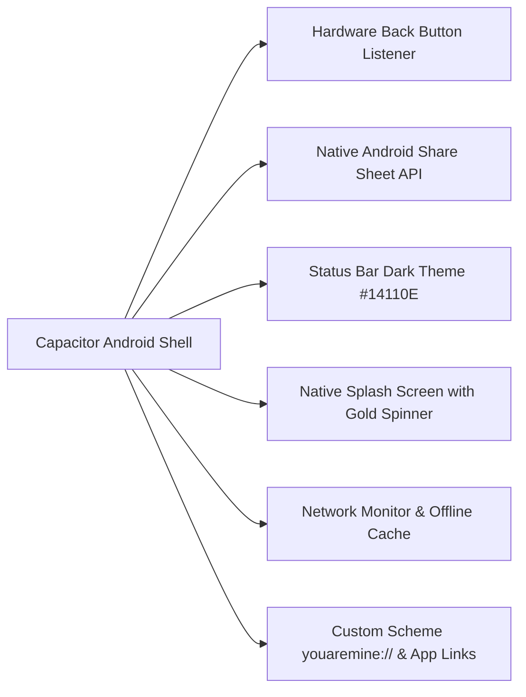

# YOU ARE MINE — Android Application Final Report
**Platform:** Google Play Store / Android 14+ (API Level 34 Ready)  
**Package Name:** `com.youaremine.app`  
**Native Engine:** Capacitor Native Hybrid Shell (`@capacitor/android` 8.6.2)  
**Build Tooling:** Android Studio / Gradle 8+

---

## 1. Native Integration Architecture

The Android application delivers an authentic native experience rather than a basic webview wrapper:

---

## 2. Implemented Native Features

1. **Hardware Back Button Handling:**
   - Listens to Android back button press events.
   - Intelligently steps backward through template tabs and personalization steps, or closes active modals, before exiting the app.

2. **Native Share Sheet (`@capacitor/share`):**
   - Direct integration with Android's system share sheet.
   - Allows users to share public invitation URLs directly to WhatsApp groups, Instagram direct messages, or copy to clipboard with a single tap.

3. **Status Bar & Safe Area Insets:**
   - Custom status bar style (`#14110E`, dark style with light text).
   - Inset handling for notches, hole-punch cameras, and gesture navigation bars.
   - `android:windowSoftInputMode="adjustResize"` ensures form inputs stay visible when the on-screen keyboard appears.

4. **Deep Linking & Google Play App Links:**
   - Custom scheme: `youaremine://template/:id`
   - Verified HTTP App Links: `https://youaremine-online.com/invite/:slug` automatically launch directly into the native Android application.

5. **Offline Resiliency & Force Update Modal:**
   - Active network status listener surfaces an offline toast when connectivity drops.
   - Synchronizes with centralized admin `/api/app/config` to display non-dismissible force-update prompts when critical updates are released on Google Play.

---

## 3. Play Store Asset Compliance Summary

| Asset | Requirement | Delivered State | Status |
| :--- | :---: | :---: | :---: |
| **App Icon** | 512x512 PNG, < 1MB | 512x512 PNG, 318KB | ✅ Verified (34/34 Tests Passed) |
| **Feature Graphic** | 1024x500 PNG, < 15MB | 1024x500 PNG, 474KB | ✅ Verified |
| **Phone Screenshots** | At least 8, 1080x1920 PNG | 8 Full Screenshots (1080x1920) | ✅ Verified |
