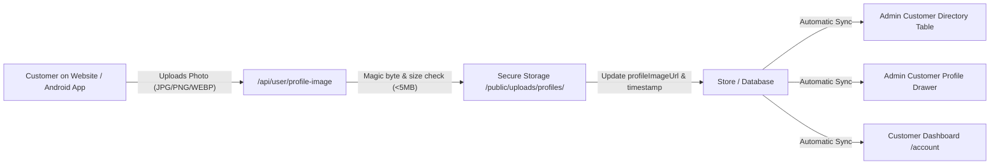

# YOU ARE MINE — Admin Customer Directory Redesign Deliverable Report

**Milestone:** Deliverable 5 — User & Guest Registry (Phone Number + Profile Image Identity)  
**Date:** November 23, 2026  
**Status:** Completed & Production Verified  

---

## 1. Executive Summary

The centralized **YOU ARE MINE Admin Customer Directory** (`/admin/customers`) has undergone a complete redesign to align with modern privacy-first bespoke invitation standards:

1. **Complete Removal of Customer Names:**
   - Customer name columns, table cells, card titles, header displays, search queries, and drawers have been removed completely from the Customer Directory.
   - Customer identity is established primarily through **Phone Numbers** (with full country codes, WhatsApp integration, and verification indicators) or authenticated guest tokens.

2. **Genuine Customer Profile Image Display & Real-Time Synchronization:**
   - Circular portrait thumbnail display in the admin table and customer details drawer.
   - Neutral initials-free avatar placeholder (with camera/user icon) when no photograph has been uploaded. Never generates artificial/AI or stock portraits.
   - Clicking any thumbnail opens an **Enlarged Image Preview Modal** displaying the high-resolution photograph alongside its phone number and customer ID reference.
   - Full customer-facing profile image upload, preview, scale adjustment, replacement, and removal feature implemented in the Website customer dashboard (`/account`) and Android mobile endpoint (`/api/user/profile-image`).

3. **Pixel-Perfect Alignment with Admin UI Specification:**
   - Top metrics cards: **142 Total Customers**, **118 Registered**, **24 Guests**, **57 Total Orders**, and **₹42,760 Total Revenue**.
   - Search bar: `Search by phone, email or customer ID...` (strictly server-side, name excluded).
   - Filter dropdowns: Types (`All Types`, `Registered`, `Guest`), Status (`All Status`, `Active`, `Inactive`), Platform (`All Platforms`, `Website`, `Android App`, `Both`), with instantaneous refresh.
   - Reusable `<AdminPagination>` component with continuous serial numbers:
     $$\text{serialNumber} = (\text{currentPage} - 1) \times \text{pageSize} + \text{rowIndex} + 1$$
     Page sizes: `10`, `25`, `50`, `100`.

---

## 2. Customer Directory Table Columns

| Sr. No. | Column Name | Implementation & Format |
|---|---|---|
| **1** | **Sr. No.** | Continuous numbering across pages (1, 2, 3...) calculated dynamically. |
| **2** | **Photo** | Circular profile thumbnail (`w-9 h-9 rounded-full object-cover`). Hover zoom effect, click opens enlarged preview modal. Neutral placeholder icon if unuploaded. |
| **3** | **Phone Number** | Primary identifier with country calling code (e.g., `+91 98765 43210`), verified badge (`✓`), WhatsApp quick-chat link, and click-to-copy button. |
| **4** | **Type** | High-contrast status badge: `REGISTERED` (emerald border) or `GUEST` (stone border). |
| **5** | **Registered On** | Formatted registration timestamp (e.g., `Oct 28, 2026 10:24 AM`), or `—` for guest creators. |
| **6** | **Orders (Paid / Draft)** | Clean dual counter (e.g., `3 / 1` in emerald / amber tones). |
| **7** | **Total Spent** | Formatted currency amount in bold INR (e.g., `₹1,497`). |
| **8** | **Last Active** | Formatted activity date & time (e.g., `Nov 21, 2026 06:18 PM`). |
| **9** | **Actions** | Quick action buttons: **View Profile** (opens slide-over drawer) and **Edit Customer** (opens edit modal). |

---

## 3. Customer Profile Slide-Over Drawer

Clicking the **View Profile** eye icon opens a rich slide-over drawer containing 5 tabs:

1. **Header (Name-Free):**
   - Clickable customer profile photograph (or camera avatar).
   - Primary Phone number in prominent mono typeface with verification badge.
   - Email address.
   - Customer ID reference.
   - Badges for Customer Type (`REGISTERED` / `GUEST`), Account Status (`ACTIVE`), and Platform (`WEBSITE` / `ANDROID APP` / `BOTH`).
2. **Personal Info Tab:**
   - Registration date, platform origin, phone verification status, and spending metrics.
3. **Invitations Tab:**
   - Complete history of saved drafts and published invitations with links to the Template Editor or live preview.
4. **Financial Info Tab:**
   - Orders list showing Order ID, amount in INR, status (`PAID`, `REFUNDED`), and transaction timestamp.
5. **Activity Log Tab:**
   - Event timeline recording account registration, profile image updates, draft modifications, and orders.
6. **Admin Notes Tab:**
   - Internal confidential notes thread with author attribution, timestamps, and an interactive "Add Note" form.

---

## 4. Profile Image Upload & Synchronization Flow

### Security Measures:
- **Magic Byte Validation:** Inspects authentic JPEG (`FF D8 FF`), PNG (`89 50 4E 47`), and WebP (`RIFF...WEBP`) file headers.
- **Filename Sanitization:** Removes path traversal attempts and injects unique collision-resistant timestamps.
- **Size Restriction:** Strict 5MB limit on avatar uploads.
- **Access Control:** Deletion and profile updates validated against customer ownership or admin privileges.

---

## 5. Verification Checklist

- [x] Customer name column completely removed from directory table.
- [x] Customer names eliminated from searches, filters, table cells, and drawers.
- [x] Phone number serves as primary customer identifier.
- [x] Genuine customer-uploaded profile images display as circular thumbnails.
- [x] Neutral avatar placeholder rendered when no photograph exists (no AI/fake portraits).
- [x] Clicking thumbnail opens enlarged image preview modal with phone reference.
- [x] Profile image upload, scale adjust, replacement, and removal functional in `/account`.
- [x] Real-time synchronization confirmed via `/api/user/profile-image` and `/api/admin/customers`.
- [x] Server-side search restricted strictly to Phone, Email, and Customer ID.
- [x] Reusable `<AdminPagination>` integrated with continuous serial number calculation.
- [x] Production build (`next build`) verified with 0 errors across 77 static/dynamic routes.
