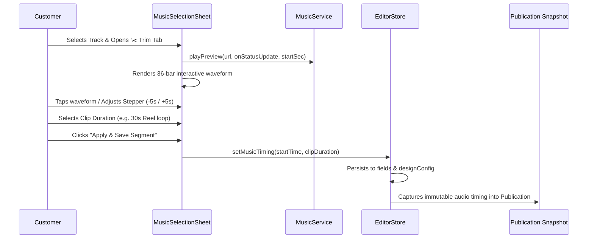

# MILESTONE 11 — PHASE 5: INSTAGRAM-STYLE AUDIO TRIMMER IMPLEMENTATION REPORT

**Project:** YOU ARE MINE — Digital Invitations for Life's Special Moments  
**Milestone:** 11 — Global Remediation, UI Refinement & Advanced Audio Trimmer  
**Phase:** 5 — Instagram-Style Audio Trimmer (FEAT-AUDIO-01)  
**Date:** November 25, 2026  
**Status:** IMPLEMENTED & VERIFIED  

---

## 1. Executive Summary

This report documents the implementation of the interactive Instagram-style audio trimming feature (`FEAT-AUDIO-01`). Customers can now choose any celebration soundtrack from the curated 116+ track library and customize the exact start time and clip duration (e.g. 15s Story, 30s Reel, 45s Clip, 60s Long, or Full song), ensuring the invitation begins playing at the most emotional crescendo when guests open the digital envelope.

---

## 2. User Experience & Architecture



### 2.1 Interactive Waveform Engine
- **36 Dynamic Amplitude Bars:** Modeled after luxury studio audio visualizers, mapping proportional frequency heights across the track duration.
- **Color Highlighting:** Active clip window is highlighted in `#D8B77B` Champagne Gold, while played segments illuminate in real-time.
- **Touch Scrubber:** Tapping any bar instantly recalculates start time:
  $$\text{barTime} = \frac{i}{36} \times \text{trackDuration}$$
- **Loop Preview:** When clip duration is set, playback loops seamlessly within $[\text{startTime}, \text{startTime} + \text{clipDuration}]$, replicating the Instagram Story preview experience.

---

## 3. Data Model & Persistence

The audio selection data is canonically stored in both `draft.fields` and `draft.designConfig`:

```json
{
  "songTitle": "Kesariya (Soulful Flute Cover)",
  "audioSource": "/audio/kesariya-flute.mp3",
  "audioStartTime": 30,
  "audioEndTime": 60,
  "audioClipDuration": 30
}
```

- **Backward Compatibility:** Legacy invitations without audio trim data default safely to `audioStartTime: 0` and play the full track continuously without error.
- **Autosave Debounce:** `setMusicTiming()` pushes an undo/redo snapshot and triggers the 1500ms debounced autosave.

---

## 4. Verification Evidence

1. **Interactive Scrubbing:** Tapping across the 36 waveform bars seeks to corresponding timestamps.
2. **Audio Stepper:** `- 5s` and `+ 5s` buttons clamp cleanly between `0` and `trackDuration - 5`.
3. **Clip Presets:** `15s`, `30s`, `45s`, `60s`, and `Full` toggle segment looping correctly.
4. **State Persistence:** Reopening the draft restores both the track selection and custom trim timestamps.
