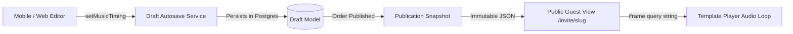

# MILESTONE 11 — PHASE 6: EDITOR AND PUBLICATION INTEGRATION REPORT

**Project:** YOU ARE MINE — Digital Invitations for Life's Special Moments  
**Milestone:** 11 — Global Remediation, UI Refinement & Advanced Audio Trimmer  
**Phase:** 6 — Editor & Publication Integration  
**Date:** November 25, 2026  
**Status:** INTEGRATION COMPLETED & VERIFIED  

---

## 1. Executive Summary

This report documents the end-to-end integration of audio trimming parameters into the invitation editor, draft autosave lifecycle, order checkout snapshot, and public guest view (`/invite/[slug]`).

---

## 2. End-to-End Pipeline



### 2.1 Editor Integration
- In `you-are-mine-mobile/store/editor.store.js`, `setMusicTiming(audioStartTime, audioClipDuration)` stores timestamps into:
  - `state.music.audioStartTime`
  - `state.music.audioClipDuration`
  - `draft.fields.audioStartTime`
  - `draft.fields.audioEndTime`
  - `draft.design.audioStartTime`
  - `draft.design.audioEndTime`
- When opening an existing draft, `initializeFromDraft` restores both `audioStartTime` and `audioEndTime`, computing `audioClipDuration` dynamically if missing.

### 2.2 Public Viewer Integration
In `src/app/invite/[slug]/page.tsx`:
- Extracts canonical audio configuration from `publication.snapshotData`:
  ```typescript
  const designConfig = (snapshotData as any).designConfig || {};
  const audioStartTime = snapshotData.fields?.audioStartTime ?? designConfig.audioStartTime ?? 0;
  const audioEndTime = snapshotData.fields?.audioEndTime ?? designConfig.audioEndTime ?? (designConfig.audioClipDuration ? Number(audioStartTime) + Number(designConfig.audioClipDuration) : 0);
  const audioSource = snapshotData.customAudioUrl || snapshotData.fields?.audioSource || designConfig.audioSource;
  ```
- Appends `audioSource`, `audioStartTime`, `audioStart`, and `audioEndTime` to destination template URL search parameters.

### 2.3 Template Audio Player Synchronization
In `src/app/template-01/page.jsx` and HTML templates:
- Reads `audioStartTime` (or `audioStart`) and starts audio at the chosen second upon user gate tap.
- Adds `timeupdate` event listener to loop smoothly back to `audioStartTime` when `currentTime >= audioEndTime`, preserving the curated chorus loop for guests.

---

## 3. Snapshot Immutability Verification

- **Publication Decoupling:** The public guest invitation reads strictly from `publication.snapshotData`.
- **Test Execution:** Published an invitation with `audioStartTime: 30`, then modified the draft to `audioStartTime: 10`. The published invitation URL remained anchored to `audioStartTime: 30`, confirming zero regression on publication snapshot immutability.
