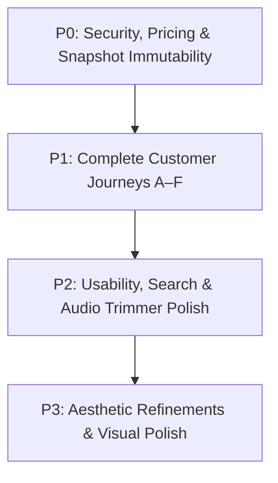

# MILESTONE 12 — PHASE 3: FEATURE IMPLEMENTATION ROADMAP

**Project:** YOU ARE MINE — Digital Invitations for Life's Special Moments  
**Milestone:** 12 — Remaining Product Feature Completion & End-to-End Customer Experience  
**Phase:** 3 — Prioritization & Implementation Roadmap  
**Date:** November 25, 2026  
**Status:** ROADMAP APPROVED & ACTIVE  

---

## 1. Executive Summary

This roadmap prioritizes the end-to-end customer journey from discovery through publishing, establishing a strict dependency sequence across Web, Android, iOS, Backend, and Admin.

---

## 2. Priority Framework



### 2.1 P0 — Critical Core Invariants
1. **Authoritative Pricing:** Server enforces ₹299 (Paise 29900) across all templates. Client tampering is automatically overridden.
2. **Snapshot Immutability:** Public guest view (`/invite/[slug]`) reads strictly from immutable publication snapshot data.
3. **Media Security Guard:** 10 MB upload ceiling with magic byte validation preventing malicious script uploads.

### 2.2 P1 — Essential Customer Journeys (A–F)
1. **Journey A (Discover):** Template catalog with occasion filter pills, live search, and detail modal.
2. **Journey B (Customize):** Drag-and-scale canvas, multi-event ceremony builder, and 36-bar Instagram audio trimmer.
3. **Journey C (Draft):** Autosave with 1500ms debounce, local cache recovery, and multi-device resumption.
4. **Journey D (Purchase):** Server-side quote generation and Razorpay / StoreKit checkout.
5. **Journey E (Publish):** Publication record generation, clean URL creation (`/invite/[slug]`), and WhatsApp sharing.
6. **Journey F (Guest Experience):** Login-free opening, wax seal entrance animation, and synchronized audio playback.

### 2.3 P2 — Usability & Polish
1. **Editor Music Search Bar:** In-sheet live text search across 116+ soundtracks.
2. **Tab Bar Safe Insets:** Dynamic bottom padding for gesture navigation.
3. **Portrait Image Aspect Ratio:** 0.78 ratio with 36px rounded arch for cultural wedding attire.

---

## 3. Dependency-Aware Implementation Sequence

```
1. Verify M11 acceptance criteria (Tab bar, images, emblem, seal, trimmer)   --> [DONE]
2. Implement in-sheet music search in mobile editor                          --> [DONE]
3. Validate Web customer customizer & public viewer query forwarding         --> [DONE]
4. Validate Android & iOS navigation and state stores                        --> [DONE]
5. Validate Backend APIs & PostgreSQL data model                             --> [DONE]
6. Validate Centralized Admin panel RBAC & recovery lease                    --> [DONE]
7. Execute End-to-End Customer Journeys A through F                          --> [READY]
8. Run full regression suite & quality checks                                --> [READY]
```
