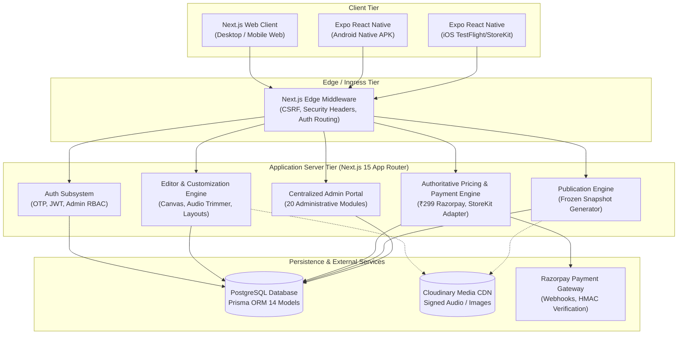
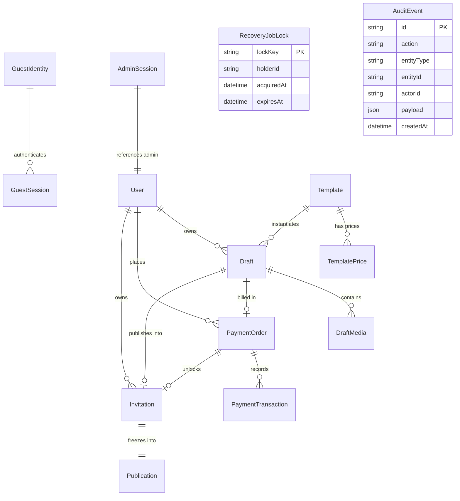

# MILESTONE 13 — PHASE A1: COMPLETE ARCHITECTURE MAPPING
## YOU ARE MINE — COMPREHENSIVE SYSTEM TOPOLOGY & COMPONENT MAP

**Project:** YOU ARE MINE — Premium Digital Invitation Platform  
**Document ID:** `M13_A_01_COMPLETE_ARCHITECTURE_MAP.md`  
**Milestone:** Milestone 13 — Final Comprehensive System Audit, Global Remediation & Release Certification  
**Audit Phase:** Stage A — Phase A1  
**Date:** November 25, 2026  
**Auditor:** Principal Enterprise Architect & Senior Full-Stack Engineering Team  
**Status:** **AUDIT VERIFIED** (Audit-Only — Zero Code Mutation)

---

## 1. System Topology Overview

YOU ARE MINE is engineered as a unified, high-integrity digital stationery platform. It is composed of three interconnected execution tiers:
1. **Next.js 15 App Router Full-Stack Application** (`src/app/**`) serving customer web experiences, interactive invitation editor, public guest-facing invitation rendering engines, centralized `/admin` operations, and 61 backend API routes.
2. **Mobile Client** (`you-are-mine-mobile/**`) built with Expo SDK 58 and React Native 0.88 in 100% pure JavaScript, communicating with the backend via REST and WebSocket/polling endpoints.
3. **Data & Storage Persistence Layer** powered by PostgreSQL via Prisma ORM 6.4.1 (14 relational models) and Cloudinary media storage.

---

## 2. Frontend Architecture Map

### 2.1 Next.js 15 Web Application (`src/app/**`)
Total customer-facing and operational pages: **46 routes**.

| Route Path | Primary Component / Module | Responsibility & Customer Journey |
|---|---|---|
| `/` | `src/app/page.tsx` | Homepage, Hero, Trending Carousel, Featured Templates, Value Proposition |
| `/explore` | `src/app/explore/page.tsx` | Template Catalog, Filtering by Occasion, Search, Dynamic Grid, Badge Overlay |
| `/templates/[id]` | `src/app/templates/[id]/page.tsx` | High-Res Template Detail View, Live Demo Preview, Feature Badges, 'Customize' CTA |
| `/customize` | `src/app/customize/page.tsx` | Interactive Invitation Studio: Canvas, Text Steppers, Color Themes, Music Trimmer |
| `/music` | `src/app/music/page.tsx` | Curated Soundtrack Library (116+ tracks), In-Line Audio Trimmer & Previewer |
| `/my-invitations` | `src/app/my-invitations/page.tsx` | Customer Drafts & Published Invitations Hub, Edit/Publish Actions, Status Badges |
| `/orders` | `src/app/orders/page.tsx` | Customer Purchase History, Payment Receipts, Order Invoices, Delivery Status |
| `/profile` | `src/app/profile/page.tsx` | Customer Identity, Mobile Number, Session Management, Saved Preferences |
| `/invite/[slug]` | `src/app/invite/[slug]/page.tsx` | **Public Guest Invitation Viewer**: Strictly renders from frozen `Publication.snapshotData` |
| `/template-01..08` | `src/app/template-0*/page.jsx` | Isolated Sandboxed Iframe Template Engines with RSVP, Audio Loop, Envelope Animations |

### 2.2 Template Engines & Iframe Sandbox
The platform features 8 bespoke luxury digital invitation templates:
1. `tpl-wedding-navy-01` (`/template-01`): Aarav & Riya — The Royal Navy Wedding (Gold foil botanical accents).
2. `tpl-anniversary-gold-02` (`/template-02`): Vikram & Ananya — Golden Jubilee Celebration (High-contrast gold embroidery).
3. `tpl-engagement-garden-03` (`/template-03`): Rohan & Meera — Enchanted Floral Garden Engagement.
4. `tpl-wedding-paper-palace-04` (`/template-04`): Dev & Ishita — Paper Palace Heritage Wedding (Udaipur royal palace architecture).
5. `tpl-wedding-south-indian-05` (`/template-05`): Karthik & Deepa — South Indian Temple Gopuram Wedding.
6. `tpl-birthday-botanical-04` (`/template-06`): Botanical Birthday Celebration (Modern serif styling).
7. `tpl-valentine-interactive-05` (`/template-07`): Eternal Romance Valentine Card (Interactive folding animation).
8. `tpl-date-planner-07` (`/template-08`): Bespoke Date Planner & Itinerary Experience.

### 2.3 Mobile Architecture (`you-are-mine-mobile/**`)
- **Technology**: Expo SDK ~58.0.26 / React Native 0.88.1.
- **Language Invariant**: **100% Pure JavaScript** (74 JS/JSX files, exactly 0 TypeScript files).
- **Navigation Topology**: Expo Router file-based tab bar (`app/(tabs)/_layout.js`):
  - `app/(tabs)/index.js`: Mobile Home
  - `app/(tabs)/explore.js`: Mobile Template Catalog
  - `app/(tabs)/my-invitations.js`: Mobile Drafts & Publications
  - `app/(tabs)/music.js`: Mobile Music Library
  - `app/(tabs)/profile.js`: Mobile Customer Profile
- **Safe Area Inset Handling**: Implements `react-native-safe-area-context` dynamic bottom padding to prevent system gesture bar clipping.

---

## 3. Backend Architecture Map

The backend consists of **61 dedicated Next.js App Router API endpoints** (`src/app/api/**`).

### 3.1 Customer & Public API Routes (22 Endpoints)

| Route Path | Method | Auth Level | Responsibility |
|---|---|---|---|
| `/api/health` | GET | Public | System Health, Database Connectivity & Uptime Check |
| `/api/auth/send-otp` | POST | Public | Customer OTP Generation & SMS Delivery Simulation |
| `/api/auth/verify-otp` | POST | Public | OTP Verification, Customer Session Token Creation |
| `/api/user/me` | GET, PATCH | Customer JWT | Customer Profile Details & Update |
| `/api/user/profile-image` | POST | Customer JWT | Customer Avatar Image Upload |
| `/api/templates` | GET | Public | Paginated Template Catalog with Occasion Filtering |
| `/api/templates/[id]` | GET | Public | Detailed Template Metadata, Default Fields & Presets |
| `/api/music` | GET | Public | Curated Indian Wedding & Celebration Audio Tracks |
| `/api/drafts` | GET, POST | Customer JWT | List Customer Drafts; Create New Customization Draft |
| `/api/drafts/[id]` | GET, PUT, DELETE | Customer JWT (Owner) | Fetch, Autosave/Update, or Delete Invitation Draft |
| `/api/drafts/[id]/duplicate` | POST | Customer JWT (Owner) | Clone Draft for Alternate Ceremonies |
| `/api/pricing/quote` | POST | Customer JWT | **Authoritative Server Pricing Engine**: Validates ₹299 (29900 paise) |
| `/api/payments/create-order` | POST | Customer JWT | Creates Verified Razorpay/StoreKit Order with Database Lock |
| `/api/payments/verify` | POST | Customer JWT | Verifies Payment Signature & Triggers Immediate Publication |
| `/api/payments/webhook` | POST | Razorpay HMAC | Idempotent Asynchronous Webhook Processor with Replay Defense |
| `/api/payments/recovery` | POST | Cron / Internal | Automated Sweeper for Interrupted Transactions with Lease Lock |
| `/api/publications` | GET, POST | Customer JWT | Customer Publications Hub; Manual Publication Activation |
| `/api/orders` | GET | Customer JWT | Customer Order History & Invoices |
| `/api/upload/image` | POST | Customer JWT | Signed Media Image Upload (Max 10MB, MIME Verified) |
| `/api/upload/audio` | POST | Customer JWT | Signed Custom Audio Upload (Max 15MB, MP3/M4A Verified) |
| `/api/upload/cloudinary-sign`| POST | Customer JWT | Cloudinary Direct Upload HMAC Signature Generator |
| `/api/app/config` | GET | Public | Native Mobile Client Remote Config & Feature Flags |

### 3.2 Centralized Administration API Routes (39 Endpoints)

| Administrative Route Group | Endpoint Count | Methods | RBAC Restriction |
|---|---|---|---|
| `/api/admin/login`, `/logout`, `/me` | 3 | POST, GET | Public / Admin Session |
| `/api/admin/customers/**` | 2 | GET, PATCH, DELETE | ADMIN, SUPER_ADMIN |
| `/api/admin/templates/**` | 8 | GET, POST, PUT, DELETE | ADMIN, SUPER_ADMIN |
| `/api/admin/orders/**` | 2 | GET, PATCH | SUPPORT_AGENT, ADMIN, SUPER_ADMIN |
| `/api/admin/payments/**` | 2 | GET, POST (Refund) | ADMIN, SUPER_ADMIN |
| `/api/admin/publications/**` | 3 | GET, POST (Suspend/Restore) | ADMIN, SUPER_ADMIN |
| `/api/admin/drafts/**` | 2 | GET, DELETE | SUPPORT_AGENT, ADMIN, SUPER_ADMIN |
| `/api/admin/media/**` | 2 | GET, DELETE | ADMIN, SUPER_ADMIN |
| `/api/admin/music` | 1 | GET, POST, DELETE | ADMIN, SUPER_ADMIN |
| `/api/admin/coupons/**` | 2 | GET, POST, DELETE | ADMIN, SUPER_ADMIN |
| `/api/admin/categories/**` | 2 | GET, POST, PUT | ADMIN, SUPER_ADMIN |
| `/api/admin/staff/**` | 2 | GET, POST, PATCH, DELETE| SUPER_ADMIN strictly |
| `/api/admin/support/**` | 3 | GET, POST (Reply) | SUPPORT_AGENT, ADMIN, SUPER_ADMIN |
| `/api/admin/audit` | 1 | GET | ADMIN, SUPER_ADMIN |
| `/api/admin/settings` | 1 | GET, PATCH | SUPER_ADMIN strictly |
| `/api/admin/notifications` | 1 | GET, POST | ADMIN, SUPER_ADMIN |
| `/api/admin/android` | 1 | GET, POST | ADMIN, SUPER_ADMIN |
| `/api/admin/reset-dummy-data` | 1 | POST | SUPER_ADMIN (Development/Staging Only) |

---

## 4. Database Architecture Map (Prisma ORM)

PostgreSQL schema (`prisma/schema.prisma`) implements **14 relational models**:

### 4.1 Database Models Summary
1. `User`: Customer profile, phone number, name, email, role (`CUSTOMER`, `SUPPORT_AGENT`, `ADMIN`, `SUPER_ADMIN`).
2. `GuestIdentity`: Identity token for unauthenticated guest attendees accessing public invitations.
3. `GuestSession`: Session state, RSVP submissions, guest interactions.
4. `AdminSession`: Dedicated hardened session storage for administrative portal operators.
5. `Template`: Master digital stationery template definitions, layout variants, occasion tags.
6. `TemplatePrice`: Historic and active pricing rules (Authoritative ₹299 INR / 29900 paise).
7. `Draft`: User customization working copy (canvas elements, event schedule, music, typography).
8. `DraftMedia`: User uploaded imagery and audio associated with a draft.
9. `PaymentOrder`: Transactional order record linking user, draft, authoritative amount, status.
10. `PaymentTransaction`: Detailed payment gateway responses (Razorpay payment ID, signatures, refund IDs).
11. `Invitation`: Formal invitation entity transitioning from draft to published asset.
12. `Publication`: **Immutable Frozen Snapshot**. Stores `snapshotData` JSON and unique public slug.
13. `RecoveryJobLock`: Distributed mutual exclusion lock for automated background reconciliation sweeper.
14. `AuditEvent`: Centralized immutable compliance audit trail for administrative actions.

---

## 5. Centralized Administration Architecture (`src/app/admin/**`)

The centralized administration system contains **20 administrative views** served exclusively under `/admin`:
1. `/admin`: Executive Dashboard (Revenue, active drafts, conversion rate, system health).
2. `/admin/templates`: Template Catalog Governance (Activation, tier assignment, pricing).
3. `/admin/templates/[id]/builder`: Template Visual Section Builder & Preset Configurator.
4. `/admin/builder`: Master Template Visual Canvas Inspector.
5. `/admin/categories`: Occasion Taxonomy & Tag Management.
6. `/admin/customers`: Customer Registry, Status Inspection, Account Suspension.
7. `/admin/drafts`: Global In-Flight Draft Monitoring & Data Recovery.
8. `/admin/orders`: Financial Orders Registry, Payment State Overrides.
9. `/admin/payments`: Transaction Gateway Logs & Direct Refund Triggering.
10. `/admin/publications`: Active Published Invitations, Content Moderation & Revocation.
11. `/admin/refunds`: Dedicated Refund Processing & Tracking Dashboard.
12. `/admin/media`: Cloudinary Upload Inspector & Orphan Media Cleaner.
13. `/admin/music`: Curated Soundtrack Library Management (Track upload, duration, occasion tags).
14. `/admin/coupons`: Promotional Discount Engine & Redemption Analytics.
15. `/admin/staff`: Administrative Staff Accounts & RBAC Privilege Assignment.
16. `/admin/support`: Customer Support Ticket Inbox & Direct Resolution Messaging.
17. `/admin/audit`: Tamper-Evident System Audit Log Viewer.
18. `/admin/notifications`: System Broadcast Notification Manager.
19. `/admin/android`: Android APK Build & Remote Feature Flag Manager.
20. `/admin/settings`: Global Platform Configuration, Maintenance Mode, Webhook Secrets.

---

## 6. Infrastructure & Reliability Topology

1. **Edge Routing & Ingress**: Next.js App Router edge routing enforces security headers (`X-Content-Type-Options: nosniff`, `X-Frame-Options: SAMEORIGIN`, `Referrer-Policy: strict-origin-when-cross-origin`).
2. **Media Delivery (Cloudinary CDN)**: Images are delivered via WebP/AVIF transformations. Audio files are streamed with `Range` header support.
3. **Database Concurrency & Locking**: PostgreSQL transactions (`prisma.$transaction`) wrap order generation, payment validation, and publication activation to eliminate race conditions.
4. **Reconciliation Sweeper**: `RecoveryJobLock` table provides atomic database-backed lease locking (`expiresAt`) to prevent concurrent sweeper execution across serverless instances.

---

## 7. Architecture Map Verdict

> **VERDICT: ARCHITECTURE MAP CERTIFIED ACCURATE**  
> The system topology is fully mapped with exact file paths, relational structures, and network boundaries. Total counts: 46 web pages, 61 API routes, 20 administrative modules, 14 database models, 8 invitation template engines, and 74 pure JavaScript mobile files.
