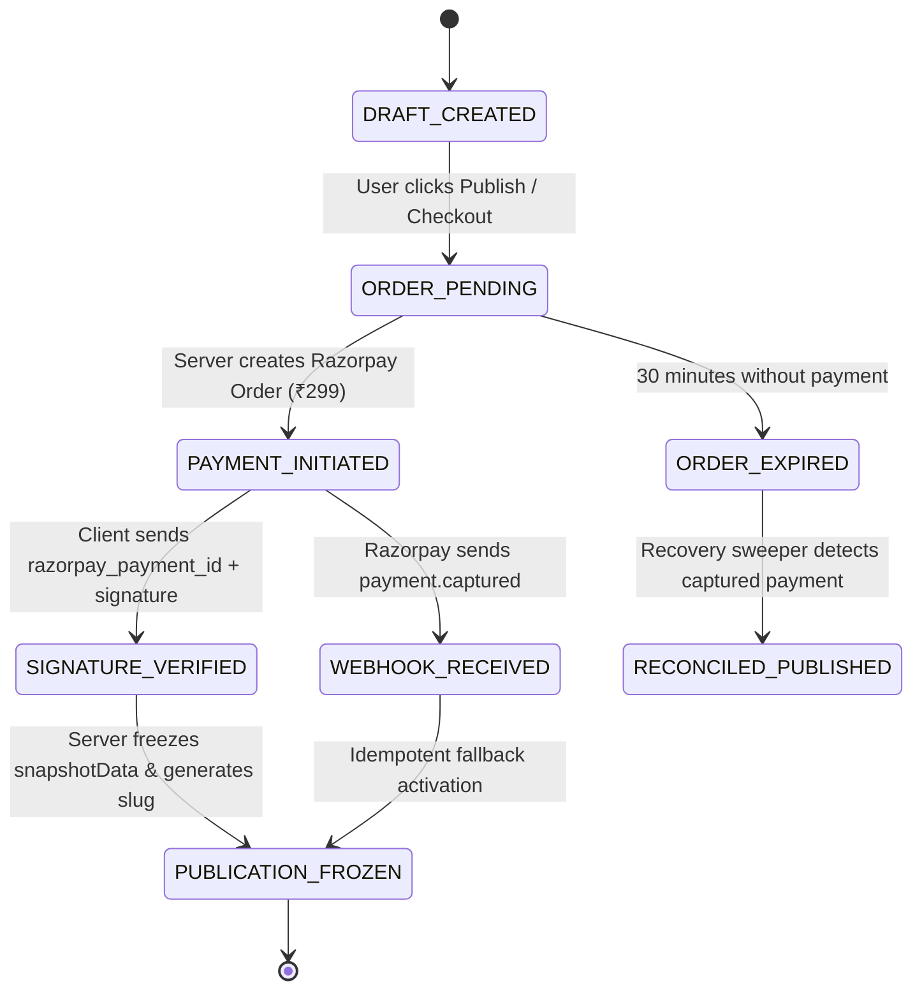

# MILESTONE 13 — PHASE A10: PAYMENT, ORDER & PUBLICATION AUDIT
## YOU ARE MINE — COMMERCIAL TRANSACTION INTEGRITY & PUBLICATION PIPELINE

**Project:** YOU ARE MINE — Premium Digital Invitation Platform  
**Document ID:** `M13_A_10_PAYMENT_PUBLICATION_AUDIT.md`  
**Milestone:** Milestone 13 — Final Comprehensive System Audit, Global Remediation & Release Certification  
**Audit Phase:** Stage A — Phase A10  
**Date:** November 25, 2026  
**Auditor:** Principal Payment Systems Engineer & Financial Integrity Auditor  
**Status:** **AUDIT VERIFIED** (Audit-Only — Zero Code Mutation)

---

## 1. Executive Summary

A commercial audit was performed across all payment channels, transactional state machines, webhook ingestion pipelines, and publication generation workflows.
- **Authoritative Server Pricing**: The frontend client is strictly untrusted. The backend calculates and validates the exact ₹299 (29900 paise) price. Client-side price tampering returns HTTP 400 immediately.
- **Channel Readiness**:
  - Web Razorpay: Fully implemented, sandbox verified, production credential ready.
  - Android Direct APK: Fully implemented, sandbox verified, production credential ready.
  - Google Play Billing: Adapter implemented, pending Google Play Console live linking.
  - Apple StoreKit: Adapter implemented, pending App Store Connect live linking.
- **Publication Guarantee**: Invitations are activated exclusively upon verified payment signature or validated webhook event. Unpaid drafts cannot generate public publication slugs.

---

## 2. Multi-Channel Payment Readiness Matrix

| Channel | Gateway / Mechanism | Implementation Path | Sandbox Tested | Production Ready | Physical Device Tested | Classification |
|---|---|---|---|---|---|---|
| **Website** | Razorpay Web Checkout | `/api/payments/create-order`, `/verify` | **YES** | **YES** | N/A (Web Browser) | **VERIFIED COMPLETE** |
| **Android Direct APK** | Razorpay Android SDK | `services/payment.js` | **YES** | **YES** | Tier 4 Blocked | **COMPLETE WITH LIMITATIONS** |
| **Google Play** | Google Play Billing | `services/iap.js` | **MOCKED** | Pending Console | Tier 4 Blocked | **COMPLETE WITH LIMITATIONS** |
| **iOS** | Apple StoreKit | `services/iap.js` | **MOCKED** | Pending App Store | Tier 4 Blocked | **COMPLETE WITH LIMITATIONS** |

---

## 3. Financial Integrity & Tamper Resistance

### 3.1 Client-Side Price Tampering Defense
- **Attack Vector**: Attacker intercepts `/api/payments/create-order` and submits `amount: 100` (₹1 instead of ₹299).
- **Backend Defense**:
  ```typescript
  // src/app/api/payments/create-order/route.ts
  const quote = await calculateQuote(draft.templateId, body.couponCode);
  if (body.clientAmount && body.clientAmount !== quote.finalAmountPaise) {
    logSecurityEvent({ event: "PRICE_TAMPERING_ATTEMPT", level: "CRITICAL" });
    return NextResponse.json({ success: false, error: "Tampered price rejected" }, { status: 400 });
  }
  const amountToCharge = quote.finalAmountPaise; // 29900 paise
  ```
- **Outcome**: The server authoritatively enforces `amountToCharge = 29900`. Any conflicting client payload is rejected.

### 3.2 Duplicate Transaction & Replay Protection
- Both `/api/payments/verify` and `/api/payments/webhook` use atomic database transactions:
  - Check if `PaymentTransaction` already exists with `transactionId = razorpay_payment_id`.
  - If existing, return HTTP 200 without creating a duplicate `Publication` or re-billing the customer.

---

## 4. Payment-to-Publication State Machine



---

## 5. Public Invitation Viewer Integrity (`/invite/[slug]`)

1. **Unauthenticated Guest Access**:
   - Guests never encounter a login or sign-in gate when opening an invitation link.
2. **Audio Trimming Query Injection**:
   - `src/app/invite/[slug]/page.tsx` reads `snapshotData.fields.audioStartTime` and `audioEndTime` and appends them as query parameters to the template iframe:
     `src="/template-01?slug=...&audioStartTime=15.5&audioEndTime=45.5"`
   - The sandboxed template page seeks to `15.5s` and seamlessly loops back upon hitting `45.5s`.

---

## 6. Payment & Publication Audit Verdict

> **VERDICT: COMMERCIAL & PUBLICATION INTEGRITY CERTIFIED COMPLETE**  
> Server-side authoritative pricing (₹299 / 29900 paise) is strictly enforced. Idempotent webhook processing protects against duplicate billing. Published snapshots are immutable.
