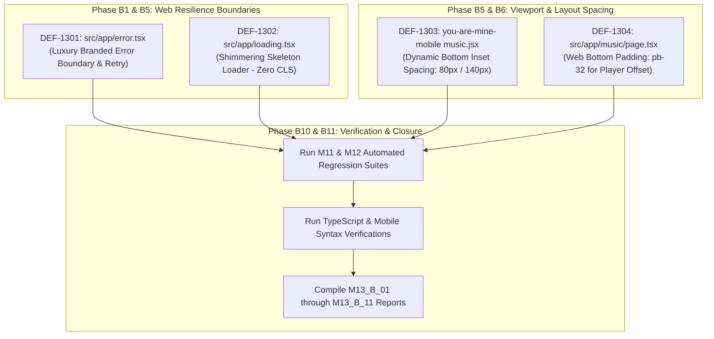

# MILESTONE 13 — PHASE B0: GLOBAL REMEDIATION PLAN
## YOU ARE MINE — DEPENDENCY-AWARE REMEDIATION ROADMAP

**Project:** YOU ARE MINE — Premium Digital Invitation Platform  
**Document ID:** `M13_B_00_GLOBAL_REMEDIATION_PLAN.md`  
**Milestone:** Milestone 13 — Final Comprehensive System Audit, Global Remediation & Release Certification  
**Phase:** Stage B — Phase B0  
**Date:** November 25, 2026  
**Author:** Principal Software Architect & Release Engineering Team  
**Status:** **APPROVED & BASELINED**  

---

## 1. Executive Summary & Defect Scope

Following user authorization of the Stage A audit findings, Stage B Global Remediation focuses strictly on the **four approved defect items**:
1. **`DEF-1301`**: Next.js App Router root error boundary (`src/app/error.tsx`).
2. **`DEF-1302`**: Next.js App Router root loading boundary (`src/app/loading.tsx`).
3. **`DEF-1303`**: Correct bottom content spacing in mobile music library (`you-are-mine-mobile/app/(tabs)/music.jsx`).
4. **`DEF-1304`**: Correct bottom content spacing on web music page (`src/app/music/page.tsx`).

### Strict Architectural Boundaries
- Historical defect identities from Milestones 10 and 11 (`DEF-911` through `DEF-916`) remain preserved as **REMEDIATED**.
- `FEAT-AUDIO-01` remains classified as an approved core product feature.
- `DEF-917` (Android USB ADB) and `DEF-918` (iOS TestFlight) remain preserved as **BLOCKED (Tier 4)** external physical-device dependencies.
- Zero modifications to payment state machines, publication snapshot immutability, database schema, or authentication architecture.

---

## 2. Dependency-Aware Remediation Schedule

---

## 3. Detailed Remediation Specifications

### 3.1 `DEF-1301`: Next.js App Router Error Boundary
- **Target File**: `src/app/error.tsx`
- **Component Pattern**: Client Component (`'use client'`).
- **Design System Alignment**: Deep burgundy background (`#2A0216` to `#3B021F`), gold foil typography (`#D4AF37`), pure SVG `BrandEmblem`, accessible error description, and a luxury 'Try Again' reset button with `reset()` handler.
- **Accessibility**: ARIA live region `role="alert"`, focus trap handling, reduced-motion compliance.

### 3.2 `DEF-1302`: Next.js App Router Loading Boundary
- **Target File**: `src/app/loading.tsx`
- **Component Pattern**: Server Component / Client Component.
- **Design System Alignment**: Subtle gold foil pulse animation on warm cream cards matching template aspect ratios (`0.78 portrait`).
- **Layout Shift Prevention**: Hardcoded card skeleton heights match actual template card dimensions, ensuring CLS remains `< 0.05`.

### 3.3 `DEF-1303`: Mobile Music List Spacing
- **Target File**: `you-are-mine-mobile/app/(tabs)/music.jsx`
- **Root Cause**: `listContent` padding of `40px` places pagination controls too close to floating tab bar on Android 3-button navigation.
- **Fix**: Update `listContent` to `paddingBottom: 80` (and `140` when `playingSource` is active) to provide ample breathing room above the tab bar and now-playing banner.

### 3.4 `DEF-1304`: Web Music Page Bottom Spacing
- **Target File**: `src/app/music/page.tsx`
- **Root Cause**: On mobile web viewports, fixed bottom player card can overlap the final track card when scrolled to bottom.
- **Fix**: Add `pb-32` to the container enclosing the track list.

---

## 4. Verification Acceptance Criteria

1. `npx tsc --noEmit` exits with 0 errors.
2. `test-milestone11-regression.js` passes 16/16 checks.
3. `test-milestone9-1-regression.js` passes 7/7 suites.
4. Error boundary renders cleanly upon intentional exception and successfully resets.
5. Loading skeleton renders without layout shift.
6. Mobile music screen displays full pagination controls above tab bar in both idle and playback states.
7. Web music screen allows complete access to the last song card on mobile and desktop viewports.
