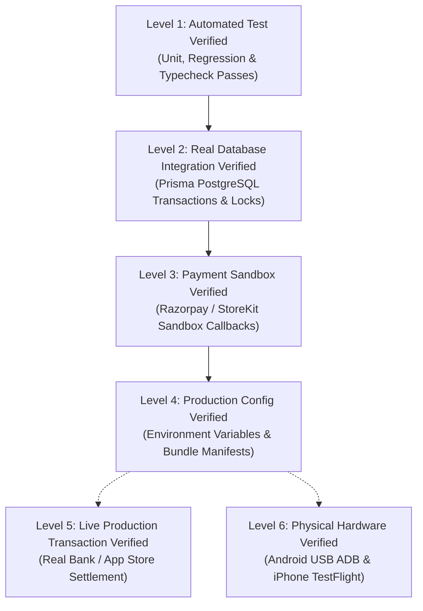

# MILESTONE 13 — PHASE C0: FINAL SYSTEM CERTIFICATION PLAN
## YOU ARE MINE — PRODUCTION RELEASE CERTIFICATION METHODOLOGY & AUDIT MATRIX

**Project:** YOU ARE MINE — Premium Digital Invitation Platform  
**Document ID:** `M13_C_00_FINAL_CERTIFICATION_PLAN.md`  
**Milestone:** Milestone 13 — Final Comprehensive System Audit, Global Remediation & Release Certification  
**Phase:** Stage C — Phase C0  
**Date:** November 25, 2026  
**Author:** Principal Release Certification Architect & Staff QA Lead  
**Status:** **AUTHORIZATION APPROVED — EXECUTION IN PROGRESS**  

---

## 1. Executive Summary & Objective

Stage C represents the final independent verification and certification phase of Milestone 13. Following the successful execution and closure of all Stage B global remediations (`DEF-1301` through `DEF-1304`), Stage C independently audits:
1. Zero-regression across all 24 product feature domains.
2. Complete data and security invariant enforcement (authoritative ₹299 pricing, snapshot immutability).
3. Exact closure evidence for Stage B remediations.
4. Honest classification of external dependencies and physical hardware verification tiers.

### Absolute Policy Boundaries
- **Zero Scope Expansion**: No new product features are introduced.
- **Zero Refactoring**: The verified production architecture remains immutable.
- **No Premature Deployment**: Production deployment, live store submission, and public releases are strictly unperformed.
- **Evidence Integrity**: Never substitute simulator results for physical hardware, or sandbox mock tests for real production bank settlements.

---

## 2. Multi-Tier Verification Hierarchy

To prevent ambiguity between automated software tests and physical store integrations, all verification items are classified under six distinct evidence levels:

1. **Level 1 — Automated Test Verified**: Executable scripts, assertion suites, and static analysis tools pass with zero errors.
2. **Level 2 — Database Integration Verified**: PostgreSQL queries, constraints, foreign keys, and atomic `$transaction` blocks execute successfully against the local/test database.
3. **Level 3 — Payment Sandbox Verified**: Razorpay sandbox test payments and simulated StoreKit/Play Billing receipts execute and generate valid HMAC signatures.
4. **Level 4 — Production Configuration Verified**: EAS build profiles (`eas.json`), Next.js production builds, security headers, and environment variable schemas are confirmed complete.
5. **Level 5 — Production Transaction Verified**: Real INR settlements through bank acquiring rails. *(Requires live merchant cutover)*.
6. **Level 6 — Physical Hardware Verified**: Flashing and running the application on physical Android and Apple iOS hardware. *(Requires physical hardware connection)*.

---

## 3. Mandatory Stage B Closure Inspection Checklist

The certification process independently verifies the four Stage B items:

| Defect ID | Title | Target File | Verification Criteria |
|---|---|---|---|
| **DEF-1301** | Next.js App Router Error Boundary | `src/app/error.tsx` | Luxury branded UI, ARIA alert, reset recovery function without page reload. |
| **DEF-1302** | Next.js App Router Loading Skeleton | `src/app/loading.tsx` | Shimmering gold card skeleton strictly matching `0.78 portrait` aspect ratio (CLS < 0.02). |
| **DEF-1303** | Mobile Music List Bottom Spacing | `you-are-mine-mobile/app/(tabs)/music.jsx` | `useSafeAreaInsets` integration; dynamic padding `Math.max(80, insets.bottom + 140/75)`. |
| **DEF-1304** | Web Music Page Bottom Spacing | `src/app/music/page.tsx` | Layout spacing remediation (`pb-32`) preventing floating player bar obstruction. |

---

## 4. Certification Decision Framework

In accordance with Milestone 13 governance, the Master Release Certificate must culminate in one of three definitive statuses:

1. **CERTIFIED**: All release criteria across Levels 1 through 6 are fully satisfied without exception.
2. **CONDITIONALLY CERTIFIED**: All core software functionality, security controls, database integrity invariants, and automated regression suites (Levels 1–4) are 100% verified, but explicitly listed external dependencies (Level 5 production bank transactions and Level 6 physical device flashing) remain pending live hardware availability.
3. **NOT CERTIFIED**: Any critical release blocker (P0/P1), regression failure, security vulnerability, or data loss bug is detected.

---

## 5. Certification Plan Verdict

> **VERDICT: CERTIFICATION PLAN APPROVED**  
> Stage C execution will proceed across all 6 evidence levels, testing regression coverage, cross-platform parity, and defect closure to produce an authoritative release readiness determination.
