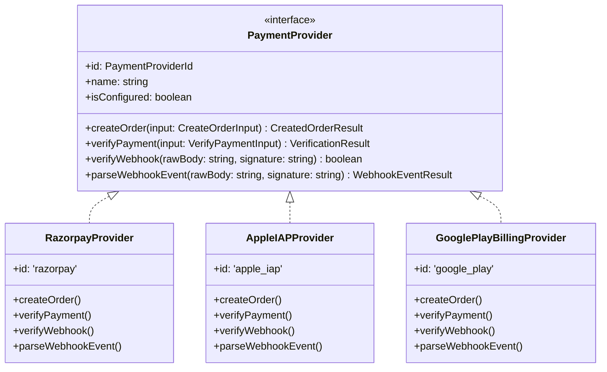

# YOU ARE MINE — MILESTONE 7B PAYMENT PROVIDER ARCHITECTURE
## Unified Payment Gateway Abstraction & Platform Boundaries

---

### 1. ARCHITECTURAL OVERVIEW

The payment subsystem abstracts gateway-specific APIs behind a polymorphic `PaymentProvider` interface, allowing the application to process payments across multiple platform contexts (Web, Android direct, Play Store, and iOS) while directing all transactions to the same database, order models, and publication pipeline.



---

### 2. PROVIDER SPECIFICATIONS & BOUNDARIES

#### A. RazorpayProvider (`src/lib/payments/providers/razorpay-provider.ts`)
- **Status:** **Active Production Gateway**.
- **Environments:** Website (`youaremine.online`), Android Direct Distribution, Android India UCB.
- **Protocol:**
  - Order Creation: REST `POST https://api.razorpay.com/v1/orders` using Basic Auth (`RAZORPAY_KEY_ID:RAZORPAY_KEY_SECRET`).
  - Signature Verification: HMAC-SHA256 constant-time digest comparison over `${orderId}|${paymentId}`.
  - Webhook Verification: HMAC-SHA256 constant-time digest over raw body with `RAZORPAY_WEBHOOK_SECRET`.
  - Normalization: Maps `payment.captured` & `order.paid` to `'CAPTURED'`, `payment.authorized` to `'AUTHORIZED'`, `payment.failed` to `'FAILED'`, and `refund.processed` to `'REFUNDED'`.

#### B. AppleIAPProvider (`src/lib/payments/providers/apple-iap-provider.ts`)
- **Status:** **Prepared StoreKit 2 Boundary**.
- **Environments:** iOS App Store.
- **Protocol:**
  - Configuration Gate: Checks `APPLE_IAP_ISSUER_ID`, `APPLE_IAP_KEY_ID`, `APPLE_IAP_PRIVATE_KEY`, `APPLE_IAP_BUNDLE_ID`.
  - Safety Rule: Throws `PaymentProviderConfigurationError` when invoked before production keys are populated. Never accepts mock client payloads.
  - Server Verification: Prepared for Apple App Store Server API (JWS verification of signed transactions).

#### C. GooglePlayBillingProvider (`src/lib/payments/providers/google-play-provider.ts`)
- **Status:** **Prepared Google Play UCB Boundary**.
- **Environments:** Android Google Play Store.
- **Protocol:**
  - Configuration Gate: Checks `GOOGLE_PLAY_SERVICE_ACCOUNT_KEY`, `GOOGLE_PLAY_PACKAGE_NAME`.
  - Safety Rule: Throws `PaymentProviderConfigurationError` when invoked before Google Play Console alternative billing enrollment is approved. Never accepts mock client payloads.
  - Server Verification: Prepared for Google Play Developer API purchase verification.

---

### 3. CONCURRENCY & DEDUPLICATION ARCHITECTURE

```mermaid
sequenceDiagram
    participant Webhook as Razorpay Webhook
    participant Client as Mobile / Web Client
    participant Deduplication as PaymentDeduplicationService
    participant Store as Unified Store / Database
    participant Publication as Publication Engine

    par Simultaneous Arrival
        Webhook->>Deduplication: isEventProcessed(eventId)?
        Client->>Deduplication: acquireOrderLock(orderId)
    end
    Note over Deduplication: Order Lock granted to Client;<br/>Webhook blocked by mutex until lock released.
    Client->>Store: verifySignature & recordPayment
    Client->>Publication: publishDraft(draftId)
    Client->>Deduplication: releaseOrderLock(orderId)
    
    Webhook->>Deduplication: acquireOrderLock(orderId)
    Webhook->>Store: getPaymentOrder(orderId)
    Note over Webhook: Order already PAID;<br/>Webhook drops redundant publication.
    Webhook->>Deduplication: markEventProcessed(eventId)
    Webhook->>Deduplication: releaseOrderLock(orderId)
```

1. **Event Deduplication**: Webhook delivery guarantees at least once, causing duplicate hits. `isEventProcessed(eventId)` stores processed IDs with a 24-hour TTL, dropping subsequent duplicates with an instant `{ status: "ok", duplicate: true }`.
2. **Order Mutex Lock**: `withOrderLock(orderId, operation)` prevents concurrent race conditions where client verification and server webhooks attempt to mutate order or publication records simultaneously.
