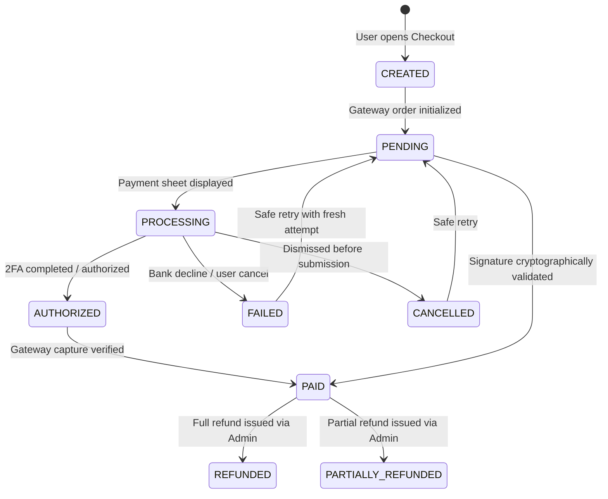

# YOU ARE MINE — MILESTONE 7B PAYMENT & ORDER STATE MACHINE

---

### 1. PAYMENT ORDER LIFECYCLE STATES

---

### 2. DETAILED STATE DEFINITIONS

| State | Definition | Permitted Next States | Re-Attempt Policy |
| :--- | :--- | :--- | :--- |
| **`CREATED`** | Order initiated in store with server quote snapshot. | `PENDING`, `CANCELLED` | Can re-calculate or update coupon. |
| **`PENDING`** | Provider transaction ID generated (`order_xxx`). Draft marked `PAYMENT_PENDING`. | `PROCESSING`, `PAID`, `FAILED`, `CANCELLED` | Customer can safely retry without duplicate active order. |
| **`PROCESSING`** | Payment SDK / gateway sheet active. Customer authenticating. | `AUTHORIZED`, `PAID`, `FAILED`, `CANCELLED` | Concurrency lock held; duplicate calls blocked. |
| **`AUTHORIZED`** | Payment authorized by bank, awaiting capture. | `PAID`, `FAILED` | Webhook or polling confirms capture. |
| **`PAID` / `CAPTURED`** | Cryptographic verification confirmed. Immutable. | `REFUNDED`, `PARTIALLY_REFUNDED` | **Terminal successful state**. Replays return existing publication idempotently. |
| **`FAILED`** | Transaction rejected by gateway or bank. | `PENDING` | Customer can immediately retry with alternative card/UPI. |
| **`CANCELLED`** | Customer dismissed checkout dialog. | `PENDING` | Draft remains intact; user can resume later. |
| **`REFUNDED`** | Admin-issued reversal. | `[*]` | Terminal state. |

---

### 3. ABANDONED CHECKOUT RECOVERY

When a customer initiates checkout but closes the app or disconnects:
1. The draft remains preserved in `PAYMENT_PENDING` status.
2. The user can reopen the app at any time and return to the draft in the Editor or My Invitations.
3. Tapping "Publish" checks if a pending order exists:
   - If a valid pending order exists within 30 minutes, it retrieves the pending status.
   - If expired or abandoned, a fresh order is initialized with the current server quote.
4. **No orphaned locks**: The in-flight mutex timeout expires automatically after 30 seconds (`LOCK_TIMEOUT_MS = 30000`).
