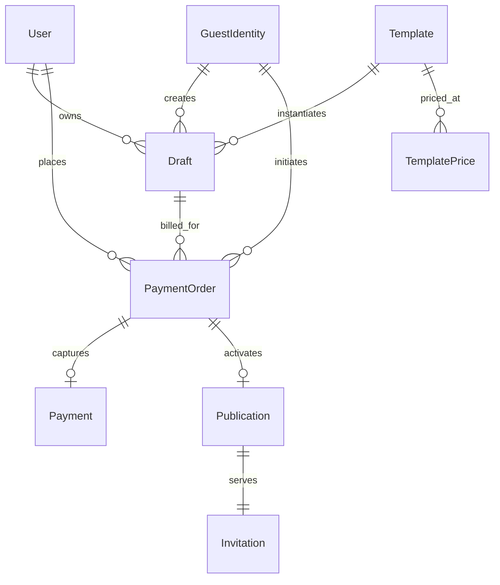

# YOU ARE MINE — MILESTONE 7 PRE-IMPLEMENTATION AUDIT
## Comprehensive Payment, Order Management & Publication Engine Audit

**Date:** November 24, 2026  
**Auditor:** Senior React Native & Backend Systems Architect  
**Scope:** Mobile App (`you-are-mine-mobile`), Next.js 15 App Router Backend, Store Persistence Layer, Centralized Admin Panel (`/admin`), Security & Ownership Protocols.

---

### 1. EXISTING API CONTRACTS AUDIT

| Endpoint Path | HTTP Method | Auth / Headers | Request Payload | Response Schema | Status Code | Existing Functionality & Notes |
| :--- | :--- | :--- | :--- | :--- | :--- | :--- |
| **`/api/pricing/quote`** | `POST` | Public / `x-guest-token` | `{ templateId: string, couponCode?: string }` | `{ success: true, quote: PricingQuote }` | `200`, `400` | Calculates authoritative server-side pricing in paise and rupees. Evaluates discount codes (`LOVE2026`, `YOUMINE50`, `FIRSTINVITE`). |
| **`/api/payments/create-order`** | `POST` | `x-guest-token` / Cookie | `{ draftId: string, couponCode?: string, customerPhone?: string, customerName?: string }` | `{ success: true, orderId: string, amount: number, currency: string, keyId: string, draftId: string, isLiveRazorpayOrder: boolean, quote: PricingQuote }` | `200`, `400`, `403`, `404`, `500` | Authenticates customer, verifies draft ownership (IDOR check), verifies draft is not already published, recalculates server quote, creates gateway order via `createRazorpayOrder`, stores `PaymentOrderRecord`, updates draft to `PAYMENT_PENDING`. |
| **`/api/payments/verify`** | `POST` | `x-guest-token` / Cookie | `{ orderId: string, paymentId: string, signature: string, draftId: string, requestedSlug?: string }` | `{ success: true, message: string, slug: string, invitationUrl: string, publicationId: string, draftId: string }` | `200`, `400`, `403`, `404`, `500` | Cryptographically verifies HMAC-SHA256 signature, validates `order.draftId === draftId`, verifies draft ownership, provides idempotency guard if already paid, marks order `PAID`, records payment, triggers atomic `store.publishDraft(...)`. |
| **`/api/payments/webhook`** | `POST` | `x-razorpay-signature` | Raw JSON event body from payment gateway | `{ status: "ok" }` | `200`, `400`, `500` | Verifies webhook HMAC signature, idempotently processes `payment.captured` and `order.paid`, records payment capture, and publishes draft if not already published. |
| **`/api/orders`** | `GET` | `x-guest-token` / Cookie | Query param: `?filter=ALL|PAID|PENDING|REFUNDED` | `{ success: true, orders: FormattedOrder[] }` | `200` | Returns customer order history associated with `guestToken` / `userId`. |
| **`/api/publications`** | `GET` | `x-guest-token` / Cookie | None | `{ success: true, publications: AugmentedPublication[] }` | `200` | Returns list of publications owned by customer with live slug and URL (`/invite/[slug]`). |
| **`/api/drafts`** | `GET`, `POST` | `x-guest-token` / Cookie | None for GET; `{ templateId, title, fields, design }` for POST | `{ success: true, drafts: DraftRecord[] }` / `{ success: true, draft: DraftRecord }` | `200`, `400` | Lists customer drafts or creates new draft. |
| **`/api/drafts/[id]`** | `GET`, `PUT`, `DELETE` | `x-guest-token` / Cookie | Payload for PUT; none for GET/DELETE | `{ success: true, draft: DraftRecord }` / `{ success: true, message: string }` | `200`, `400`, `403`, `404` | Retrieves, updates, or deletes an owned draft with IDOR ownership validation. |
| **`/api/drafts/[id]/duplicate`** | `POST` | `x-guest-token` / Cookie | None | `{ success: true, draft: DraftRecord }` | `200`, `403`, `404` | Duplicates draft server-side with `(Copy)` title suffix. |

---

### 2. DATABASE MODELS & SCHEMA RELATIONS

The storage architecture (`prisma/schema.prisma` & `src/lib/store.ts`) defines unified models shared between website and mobile:



#### Detailed Model Specifications:
1. **`DraftRecord`**:
   - `id`: Unique draft identifier (`drf_...`).
   - `guestToken`: Anonymous HMAC-signed guest token (`gst_...`).
   - `userId`: Optional authenticated customer ID (`usr_...`).
   - `templateId`: Template identifier (`tpl-...`).
   - `title`: User-defined invitation title.
   - `fields`: Key-value map of ceremony details (`names`, `weddingDate`, `venue`, `couple_photo`, `music_url`, etc.).
   - `design`: Visual design properties, coordinates, sections array, typography choices.
   - `status`: Lifecycle enum: `DRAFT` | `PAYMENT_PENDING` | `PUBLISHED`.
   - `version`: Monotonically increasing revision counter.
2. **`PaymentOrderRecord`**:
   - `id`: Internal order identifier (`order_...`).
   - `orderId`: Gateway order reference (Razorpay `order_xxx` or provider reference).
   - `draftId`: Foreign key to `DraftRecord.id`.
   - `guestToken` / `userId`: Customer identity reference.
   - `amount`: Payable amount strictly stored in **paise** (e.g. ₹299 = `29900`).
   - `currency`: ISO currency code (`INR`).
   - `status`: `CREATED` | `PENDING` | `PAID` | `FAILED` | `REFUNDED`.
   - `notes`: Metadata snapshot containing coupon applied, customer name, phone, discount in paise.
3. **`PaymentRecord`**:
   - `id`: Internal transaction ID.
   - `paymentId`: Gateway payment identifier (Razorpay `pay_...` or provider receipt).
   - `orderId`: Foreign key to `PaymentOrderRecord.id`.
   - `amount`: Captured amount in paise.
   - `status`: `CAPTURED` | `REFUNDED` | `FAILED`.
   - `signature`: Gateway verification signature hash.
   - `verifiedAt`: Timestamp of server-side cryptographic verification.
4. **`PublicationRecord`**:
   - `id`: Publication identifier (`pub_...`).
   - `draftId`: Linked draft.
   - `templateId`: Linked template.
   - `invitationId`: Reference to `InvitationRecord`.
   - `paymentId`: Reference to verified `PaymentRecord.id`.
   - `snapshotData`: **Immutable snapshot** of all fields, custom design, music, and template version at moment of publication.
   - `expiresAt`: 1-year hosting validity date.
5. **`InvitationRecord`**:
   - `id`: Public invitation identifier.
   - `slug`: Unique human-readable URL slug (e.g. `karthik-meenakshi-celebration`).
   - `isPublic`: Boolean visibility toggle.
   - `viewCount`: Total guest visits recorded.

---

### 3. PAYMENT & PUBLICATION STATE MACHINES

#### Payment State Transitions:
```
[CREATED] ──(Gateway Session Initialized)──> [PENDING]
    │                                           │
    ├──(Crypto Verification Fails)─────────────> [FAILED]
    │                                           │
    ├──(Signature Validated / Webhook)─────────> [PAID / CAPTURED]
    │                                           │
    └──(Customer Cancellation)────────────────> [CANCELLED]
                                                │
[PAID] ──(Admin Initiated Refund)──────────────> [REFUNDED]
```

#### Publication State Transitions:
```
[DRAFT] ──(Create Order)──> [PAYMENT_PENDING]
    │                             │
    │                   (Payment Verified)
    │                             ▼
    └───────────────────────> [PUBLISHED] ──(Admin Review)──> [SUSPENDED]
```

---

### 4. PRICING & COUPON LOGIC

- **Authoritative Source**: `calculateQuote(templateId, couponCode)` in `src/lib/pricing.ts`.
- **Base Pricing**: Derived from `templatesData` or `store.getTemplatePrice(templateId)`. Defaults to ₹299 (`29900` paise) or ₹449 (`44900` paise).
- **Server-Managed Promo Codes**:
  - `LOVE2026`: 20% percentage discount.
  - `YOUMINE50`: Flat ₹50 discount (`5000` paise).
  - `MINE50`: Flat ₹50 discount (`5000` paise).
  - `FIRSTINVITE`: 15% percentage discount.
- **Tamper Protection**: `POST /api/payments/create-order` recalculates `calculateQuote` independently on the server. If the client sends an altered price in the payload, the server rejects or overwrites it with the authoritative quote.

---

### 5. ADMIN PANEL & FINANCE INTEGRATION

The centralized `/admin` panel integrates directly with these models:
- **Finance Dashboard (`/admin/payments`)**: Displays Gross Captured Revenue, Net Revenue, Refunds, and list of transactions with customer phone, order ID, amount, and payment status.
- **Orders Dashboard (`/admin/orders`)**: Displays orders with status pills (`Paid`, `Pending`, `Refunded`), TKT identifiers, and template details.
- **Coupons Management (`/admin/coupons`)**: Displays active coupon codes, discount rates, and usage counts.
- **Live Publications (`/admin/publications`)**: Displays live URLs, view counts, and suspension controls.

---

### 6. SECURITY RISKS & MITIGATION STATUS

1. **Client Price Tampering (Risk: HIGH)**:
   - *Mitigation*: Client amount is never trusted. Server recalculates quote directly from database template price and promo code repository.
2. **Insecure Direct Object Reference - IDOR (Risk: CRITICAL)**:
   - *Mitigation*: `verifyOwnership(draft, guestToken)` is strictly enforced on order creation and payment verification. A customer cannot initiate an order or publish another customer's draft.
3. **Payment Signature Replay (Risk: HIGH)**:
   - *Mitigation*: Constant-time HMAC-SHA256 signature verification. Replay of an already-paid order returns the idempotent existing invitation without duplicating charges or creating duplicate publications.
4. **Duplicate Webhook Processing (Risk: MEDIUM)**:
   - *Mitigation*: Idempotent processing check: `if (order && order.status !== "PAID")`. Duplicate delivery does not re-publish or double-credit.
5. **Slug Collision (Risk: MEDIUM)**:
   - *Mitigation*: Hex hash salt fallback (`baseSlug + "-" + randomBytes(2)`) if the requested slug is already taken.

---

### 7. MISSING MOBILE FUNCTIONALITY IDENTIFIED

1. Mobile Checkout UI screens (`PublicationCheckoutScreen`, `OrderSummaryCard`, `CouponInput`, `PaymentProcessingScreen`, `PaymentSuccessScreen`).
2. Payment Provider Adapter architecture to support multi-provider dispatching (Razorpay vs In-App Billing vs Web Checkout Bridge).
3. Mobile draft checkout state bridge allowing customers to finalize payment and receive immediate status synchronization.
