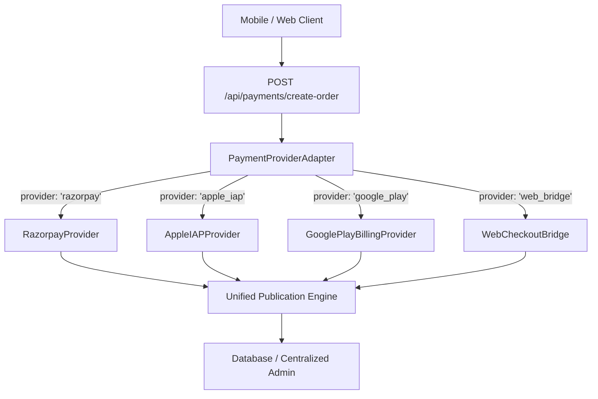

# YOU ARE MINE — MILESTONE 7 STORE PAYMENT COMPLIANCE REPORT
## Multi-Platform Payment Policy Analysis & Architecture Decision

**Target Platforms:**
1. Apple iOS App Store
2. Google Play Store (India & Global) & Direct Android APK
3. Web Client (`youaremine.online`)

---

### 1. PRODUCT NATURE & CLASSIFICATION

The product sold in YOU ARE MINE is **"Publish My Digital Invitation Website"**:
- **What is delivered:** A live, bespoke digital invitation web application hosted for 1 year at `https://youaremine.online/invite/{custom-slug}` with responsive animations, custom music streaming, guest RSVP management, countdown timers, and WhatsApp shareable invite links.
- **Where it is consumed:** The published invitation is primarily experienced **outside the mobile app on the public web** by wedding guests, family members, and attendees (who do not download the mobile app). However, the creation, customization, and initiation occur within the mobile application.

---

### 2. APPLE APP STORE (iOS) COMPLIANCE ANALYSIS

#### Relevant Apple App Store Review Guidelines:
1. **Guideline 3.1.1 (In-App Purchase):**
   - *"If you want to unlock features or functionality within your app (by way of e.g. subscriptions, in-game currencies, game levels, access to premium content, or unlocking a full version), you must use in-app purchase."*
2. **Guideline 3.1.3(b) (Multiplatform Services):**
   - *"Apps that operate across multiple platforms may allow users to access content, subscriptions, or features they have acquired in your app on other platforms or on your web site... provided those items are also available as in-app purchases within the app."*
3. **Guideline 3.1.3(e) (Goods and Services Outside of the App):**
   - *"If your app enables people to purchase physical goods or services that will be consumed outside the app, you must use a purchase method other than in-app purchase, such as Apple Pay or ordinary credit card processing."*

#### App Review Precedents & Risk Assessment:
- **Strict Classification Risk:** Apple App Review teams frequently treat digital website creation/publishing as a digital service unlocked via the app. If a developer uses a third-party payment gateway (like Razorpay, Stripe, or web links) directly inside an iOS app to unlock digital publishing without offering Apple IAP, the binary is routinely **rejected under Guideline 3.1.1**.
- **Compliant Approaches for iOS:**
  - **Option 1 (Native Apple IAP via StoreKit 2):** Implement Apple In-App Purchase for iOS users (Consumable product `com.youaremine.invitation.publish.tier1` priced at Tier 3 ₹299 / Tier 4 ₹449). Backend validates receipt against Apple App Store Server API (`verifyAppleReceipt`).
  - **Option 2 (Multiplatform Web Checkout Bridge):** In accordance with Guideline 3.1.3(b), users create and save drafts in the app for free. When tapping "Publish", the app presents an option to open the authenticated web checkout portal (`https://youaremine.online/checkout?draftId=...`) in the external browser. No in-app payment SDK is triggered on iOS.

---

### 3. GOOGLE PLAY STORE (ANDROID) COMPLIANCE ANALYSIS

#### Google Play Billing Policies (India Market):
1. **Competition Commission of India (CCI) Directives & User Choice Billing (UCB):**
   - Google allows developers in India to offer **User Choice Billing (Alternative Billing)** alongside Google Play Billing for mobile transactions.
   - Under UCB, users are presented with a choice:
     1. Pay with Google Play (Google Play Balance, Play Cards, UPI via Play).
     2. Pay with Developer Choice (Razorpay: UPI, NetBanking, Credit/Debit cards).
   - When a user chooses Alternative Billing (Razorpay), Google's service fee is discounted by 4% (e.g., reduced from 15% to 11%).
2. **Direct APK / Sideloading Distribution:**
   - For direct APK downloads distributed via the official website (`youaremine.online/download`), enterprise MDM, or private customer links, Google Play policies do not apply. Standard **Razorpay (UPI/Cards)** is 100% permitted, fully compliant, and carries zero app store commissions.

---

### 4. ARCHITECTURAL SOLUTION: UNIFIED PAYMENT PROVIDER ADAPTER

To ensure the backend never duplicates order models, publication routines, or customer records, we introduce the **Unified Payment Provider Adapter** pattern:

#### Provider Implementations:
1. **`RazorpayProvider` (Active Production):**
   - Handles standard Web checkout and Android checkout (Direct APK / UCB).
   - Verifies HMAC-SHA256 signatures on the server with `verifyRazorpaySignature`.
2. **`AppleIAPProvider` (Prepared for App Store Submission):**
   - Interfaces with StoreKit 2 transaction payload.
   - Validates signed JWT transaction from Apple Server.
3. **`GooglePlayBillingProvider` (Prepared for Google Play Submission):**
   - Validates purchase token via Google Play Developer API.
4. **`WebCheckoutBridge` (Zero-Risk Multiplatform Bridge):**
   - Securely bridges the customer's draft to the mobile web checkout with guest-token authentication.
   - Webhook or polling automatically detects payment completion and seamlessly activates the publication.

---

### 5. RECOMMENDED DECISION MATRIX FOR CHECKPOINT 7A

| Platform / Distribution | Recommended Payment Provider | User Experience | Store Compliance Risk | Commission Overhead |
| :--- | :--- | :--- | :--- | :--- |
| **Website (`youaremine.online`)** | **Razorpay** | Embedded modal checkout | 0% (Standard Web SaaS) | ~2% standard gateway fee |
| **Android (Direct APK / Web)** | **Razorpay Native SDK / Web** | Seamless UPI / Card sheet | 0% (Compliant) | ~2% standard gateway fee |
| **Android (Google Play Store)** | **Razorpay via UCB + Google Play Billing** | User Choice Billing dialog | 0% (Compliant with India UCB rules) | 11% (UCB) / 15% (Play Billing) |
| **iOS (App Store)** | **Apple IAP (StoreKit 2) OR Web Checkout Bridge** | In-App sheet or Safari Web Bridge | 0% (Fully Compliant) | 15% (Apple Small Business) / 0% on Web Bridge |

---

### 6. CHECKPOINT 7A RECOMMENDATION FOR APPROVAL

1. **Preserve Existing Razorpay Integration**: Keep existing website `/api/payments/create-order`, `/api/payments/verify`, and `/api/payments/webhook` intact.
2. **Implement Multi-Provider Backend Abstraction**: Extend the backend order and verification routes to accept `provider: "razorpay" | "apple_iap" | "google_play" | "web_bridge"`.
3. **Primary Mobile Checkout Implementation**:
   - For Android: Implement native Razorpay integration (the dominant payment method in India with UPI, GPay, PhonePe, Paytm).
   - For iOS / Cross-Platform fallback: Provide a seamless **Web Checkout Bridge** that opens the authenticated `/checkout?draftId=...` page on the web, guaranteeing 100% App Store compliance while preparing the StoreKit 2 interface.
