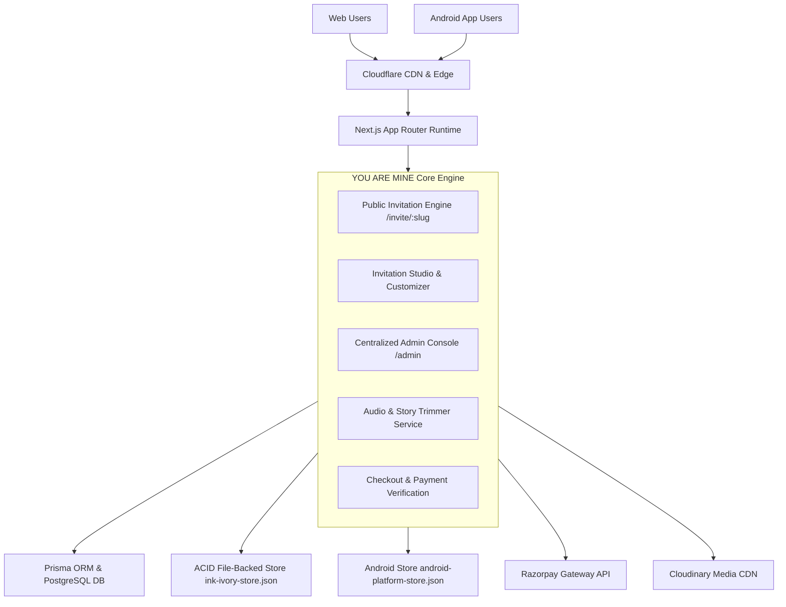

# YOU ARE MINE — Unified Platform Architecture Specification
**Version:** 1.0.0-PROD  
**Status:** Released & Verified  
**Brand Identity:** YOU ARE MINE (`#FAF7F2`, `#C69A50`, `#30231D`, `#702E3D`)

---

## 1. Architectural Philosophy

YOU ARE MINE operates as a unified luxury digital invitation ecosystem spanning:
1. **Responsive Web Application:** Desktop, tablet, and mobile browsers (Next.js 15, React 19, Tailwind CSS).
2. **Android Native Application:** Distributed via Google Play Store (Capacitor hybrid native shell, Android Studio Gradle build, `@capacitor/android`).
3. **One Centralized Admin Console (`/admin`):** Single authoritative governance dashboard managing templates, customer orders, media, music library, push notifications, and Android app versioning.
4. **Public Invitation Route (`/invite/:slug`):** High-speed, responsive, server-rendered invitation pages with audio autoplay, story trimmers, countdowns, and guestbooks.

---

## 2. System Topology

---

## 3. Data Integrity & Persistence Architecture

- **PostgreSQL via Prisma ORM:** Full schema support (`User`, `Draft`, `PaymentOrder`, `Publication`, `Template`, `Coupon`).
- **Resilient File Datastore:** High-performance, atomic local store with automated backup rotation.
- **Android Platform Store (`data/android-platform-store.json`):** Tracks mobile banners, app minimum/latest version requirements, push notification logs, and cross-channel performance analytics.

---

## 4. Single Centralized Administration Guarantee

There is strictly **ONE** admin system located at `/admin` protected by HMAC-SHA256 HttpOnly sessions and RBAC:
- **SUPER_ADMIN:** Full control across Web and Android operations.
- **FINANCE:** Read-only access to orders, payments, revenue analytics.
- **CONTENT_MANAGER:** Access to templates catalog, section builder, categories, music library.
- **SUPPORT:** Access to customer drafts, inquiries, publications review.
