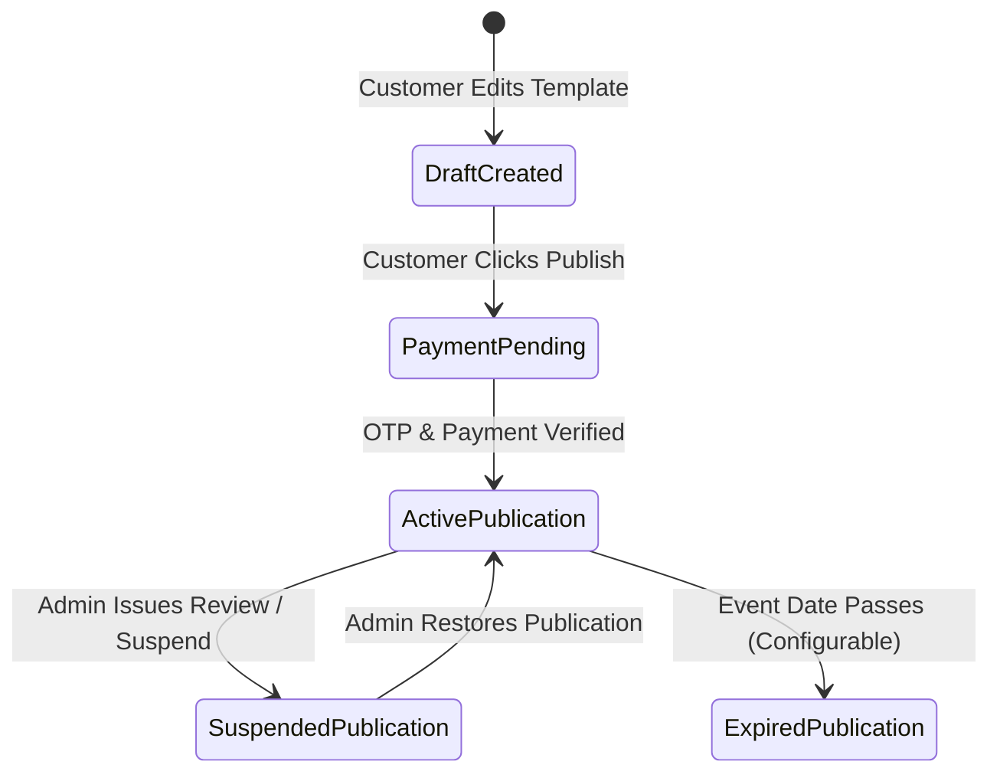

# YOU ARE MINE — Public Invitation System Specification
**Route:** `https://youaremine-online.com/invite/:slug`  
**Security Level:** Public Edge Rendered (Read-Only)  
**Brand Identity:** YOU ARE MINE

---

## 1. Public Lifecycle State Machine

---

## 2. Core Functional Requirements

1. **Unique Slug Provisioning:**
   - Slugs are provisioned idempotently upon payment verification (e.g., `/invite/aarav-riya-wedding`).
   - Collision detection appends high-entropy identifiers if custom requested slugs conflict.

2. **Full Responsive Presentation:**
   - Embedded full-bleed responsive iframe presenting the tailored invitation template.
   - Preserves high-definition animated palace doors, interactive love letter envelopes, and photo galleries across desktop and smartphone aspect ratios.

3. **Audio Autoplay & Sound Experience:**
   - Preloads customer-selected soundtrack (e.g. *Mangal Rang*, *Alfaaz*, *Din Shagna Da*).
   - Complies with browser autoplay policies: if auto-start is restricted, displays a golden music button inviting the guest to listen.

4. **Interactive Guest Features:**
   - **RSVP Form:** Captures guest names, attendance count, and dietary preferences.
   - **Guestbook & Wishes:** Allows guests to leave congratulations and blessings.
   - **Venue Navigation:** Direct links to Google Maps and Apple Maps with ceremony schedule countdowns.

5. **Omnichannel Sharing:**
   - Floating Share Button triggers native Android share sheet or clipboard copy.
   - Pre-formatted invitation text optimized for WhatsApp group broadcasts.
